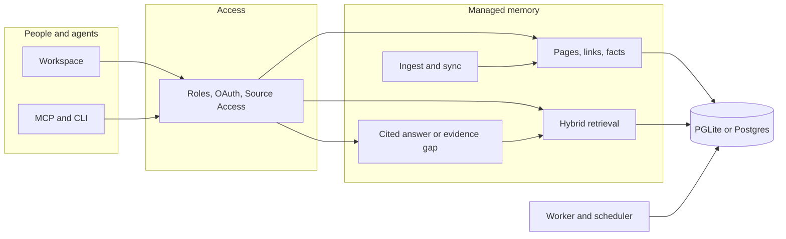
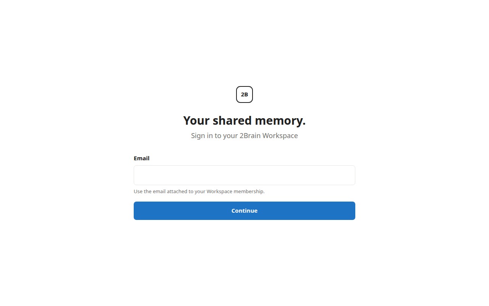

# 2Brain

A company AI assistant with a managed memory layer: shared knowledge, permissioned retrieval, and agents that answer only from Sources they are allowed to see.

This repository is the public incubation edition of the project. The command-line package and configuration keys remain named `gbrain` for compatibility.

## Problem

Company knowledge is split across documents, chat, mail, meetings, and the laptops of the people who were in the room. A personal assistant can remember one user. A company needs the same continuity for many people and many agents, with a record of where an answer came from and a hard stop when the caller should not see the source.

## Solution

2Brain keeps that memory in one Brain per deployment and puts a Workspace in front of it. Members search and ask. Agents call the same tools over MCP. Source Access decides what each caller can touch. When the pages on hand cannot support an answer, the product says so.

## Capabilities

**Managed memory.** Pages keep versions, tags, typed links, and timelines. Import, git sync, and webhooks land files and events in the brain. Hybrid retrieval combines keyword and vector search, with graph traversal beside it. Facts can be extracted, recalled, and forgotten. `think` and Ask 2Brain cite the pages they used, or return an evidence gap.

**A workspace, not a single-user bot.** One deployment is one Workspace and one Brain. People sign in as administrators or members. Invitations carry a role and a Source Access mode: all Sources, specific Sources, or none. Connected apps go through OAuth consent and inherit the member's grants. Agents are named identities with an owner, a read, write, or admin scope, and their own grants. Activity, retention, and export stay inside that boundary.

**Integrations.** The CLI and an MCP server (stdio, or HTTP with OAuth) expose one operation contract. Coding agents can attach through the guides in `docs/mcp/`. Recipes cover meeting transcripts, mail, calendar, and voice. Embeddings can use a hosted provider or a local model. Keyword search works before any embedding key is set.

**Agent and tool use.** Agents do not get a private copy of the archive. They call tools: search, fetch a page, write a page, traverse links, recall facts, submit a background job. Remote callers are untrusted. A missing grant fails closed. Agent workspaces do not receive root, a Docker socket, direct database access, platform credentials, or a trusted local CLI. Workers and a scheduler run sync, maintenance, retention, and agent jobs off the request path.

## Architecture



A module-level map is in [docs/ARCHITECTURE.md](docs/ARCHITECTURE.md).

## Demo

Sign-in from a local `gbrain serve --http` (loopback, PGLite, no model key):



Keyword search after `import --no-embed` of one fabricated note. The query `open decision` returned the page:

```text
[0.4924] onboarding -- # Example Co onboarding

Avery Chen owns the launch checklist.

Open decision: whether the pilot inc
```

A signed-in Home capture is still open. This run did not configure magic-link email, and the workspace control plane will not initialize inside a database that already has brain tables. The sign-in screen above is the workspace shell; the search transcript is the memory layer.

## Quick start

Requirements: [Bun](https://bun.sh/) 1.3.10 or newer, and Git.

```bash
git clone https://github.com/azxav/2brain-techawards.git
cd 2brain-techawards
bun install --frozen-lockfile
bun run src/cli.ts init --pglite --no-embedding
bun run src/cli.ts doctor
```

Put markdown in a folder and query it:

```bash
bun run src/cli.ts import ./notes --no-embed
bun run src/cli.ts search "open decision"
bun run src/cli.ts think "summarize the project risks with sources"
```

`think` calls a chat model. Set a provider key first, or stay on `search`, which does not need one.

Serve the brain to an agent:

```bash
bun run src/cli.ts serve
```

Postgres, HTTP MCP, and the workspace process are in [installation](docs/INSTALL.md), [engines](docs/ENGINES.md), [MCP deploy](docs/mcp/DEPLOY.md), and [clean start](docs/operations/2brain-clean-start.md). Copy [.env.example](.env.example) when a deployment needs keys.

## Tech stack

- TypeScript on Bun
- Express for HTTP MCP and the workspace shell
- PGLite for a local brain; Postgres and pgvector when the brain outgrows one machine
- Model Context Protocol SDK for agent tools
- Vercel AI SDK providers for chat and embeddings
- Zod for operation inputs

## Roadmap

The workspace shell already covers Home, Knowledge, Search, Ask, agents, and settings. Later work, still absent from this tree:

- Rich page editing in the browser
- A persistent conversation transcript inside the product (Ask stays a single question)
- Enterprise single sign-on
- First-party live connectors for Drive, Slack, and Notion (mail, calendar, meetings, and voice exist as recipes)
- More than one Workspace on a deployment

## Security and privacy

- Public fixtures use fabricated identities.
- Secrets and private source data must never be committed.
- OAuth scopes and Source Access grants constrain remote reads and writes.
- Trusted-local behavior requires `OperationContext.remote === false`.
- Security reports follow the process in [SECURITY.md](SECURITY.md).

## Development

```bash
bun install --frozen-lockfile
bun run verify
bun run test:full
```

`bun run verify` is the lint and typecheck gate. `bun run test` is the unit suite. `bun run test:full` adds the slow tests and, when `DATABASE_URL` is set, the database end-to-end tests. See [testing](docs/TESTING.md) and [contributing](CONTRIBUTING.md).

GitHub Actions runs that verify gate and the unit suite on pull requests. The workflows in `.github/workflows/` also cover sharded tests, secret scanning, and Postgres end-to-end checks.

## Documentation

- [Architecture](docs/ARCHITECTURE.md)
- [Installation](docs/INSTALL.md)
- [Testing](docs/TESTING.md)
- [Architecture index](docs/architecture/KEY_FILES.md)
- [MCP integration](docs/mcp/)
- [Schema packs](docs/architecture/schema-packs.md)
- [Agent documentation map](llms.txt)

## Built on gbrain

2Brain is built on [gbrain](https://github.com/garrytan/gbrain) by Garry Tan. The MIT license and its copyright notice are kept in [LICENSE](LICENSE).

## License

MIT. See [LICENSE](LICENSE).
