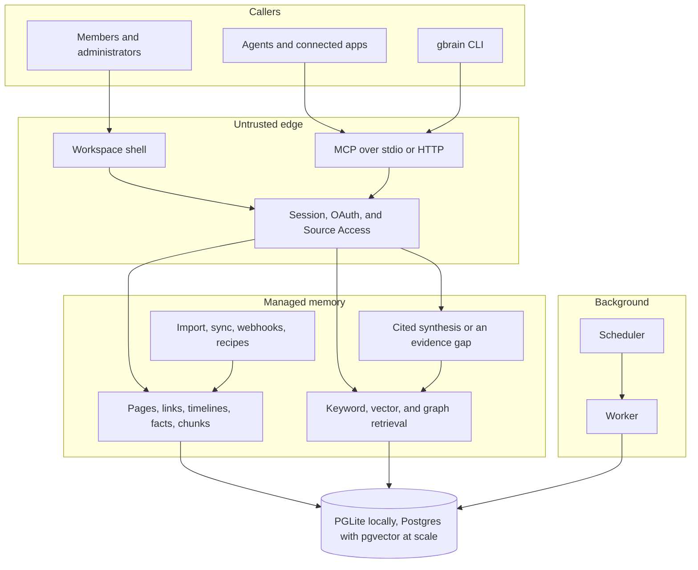

# Architecture

2Brain is one product: a company workspace in front of a durable brain. People and agents use the same knowledge, and every remote caller is limited to the Sources it was granted.

The command-line package, configuration keys, and database interfaces stay named `gbrain`. That name is the compatibility surface, not a second product.

## Shape

One deployment hosts one Workspace and one Brain. Membership decides who can sign in. Source Access decides which Sources that person, connected app, or agent can read or write. Changing the agent runtime tier does not create another tenant.

Trusted local behavior exists only when `OperationContext.remote === false`. HTTP, MCP, connected apps, and agent runtimes are remote. A missing Source Access grant fails closed. An agent workspace does not receive root, a Docker socket, direct PostgreSQL access, platform credentials, or a trusted local CLI.

## Memory

The brain stores markdown pages with versions, tags, typed links, and timelines. Import and sync bring in files and git sources. Webhooks and the recipes under `recipes/` cover meetings, mail, calendar, and voice. Chunks are embedded when a provider is configured. Keyword search still runs with `--no-embedding`.

Retrieval lives in `src/core/search/`. Hybrid search fuses keyword and vector hits, then applies ranking, dedup, and optional reranking. Graph traversal, fact recall, contradiction checks, and code-reference tools sit on the same operation contract as page search.

Answers are a separate step. `think` and the workspace Ask flow synthesize from retrieved pages and keep citations. Ask is a temporary result. When the retrieved pages cannot support an answer, the workspace returns an evidence gap instead of an uncited guess.

## Workspace

`src/workspace/` is the control plane: identities, administrator and member roles, invitations, Sources, grants, connected apps, agents, activity, retention, export, and the attention queue. Its schema is separate from the legacy brain initializer. A clean workspace database does not import an old brain.

`src/web/workspace-shell.ts` and `src/web/workspace-router.ts` render the signed-in product: Home, Knowledge, Search, Ask, page detail, agents, and settings. Authorization is enforced on the server.

Agents are durable identities with an owner, a cumulative scope (`read`, `write`, or `admin`), and their own Source Access. Scope never widens a grant. Structured activity records what an agent did, filtered to Sources the viewer can access.

`src/workspace/runtime.ts` runs the worker and the scheduler. They heartbeat, sync and maintain Sources, apply retention, and drain agent and export jobs.

## Agent and tool surface

`src/core/operations.ts` is the shared contract. The CLI (`src/cli.ts`) and the MCP server (`src/mcp/`) both call it. HTTP MCP adds OAuth, scope checks, and rate limits in `src/commands/serve-http.ts`. Tool definitions are generated from the operation list, so the CLI and MCP do not drift into two APIs.

Skills under `skills/` are markdown procedures an agent can load. They tell an agent how to ingest, query, enrich, and maintain a brain. They are not a second memory store.

## Cloud control plane

`cloud/` provisions workspace machines. It has its own package, database, and tests. It does not share a process with the brain. The registry records identity, invites, and provisioning state. A reconciler advances one step at a time: credentials, instance, DNS, health, then a setup link.

## Where to read next

| Question | File |
|---|---|
| File-level invariants before editing `src/` | `docs/architecture/KEY_FILES.md` |
| Vocabulary | `CONTEXT.md` |
| Retrieval pipeline | `docs/architecture/RETRIEVAL.md` |
| Brains and Sources | `docs/architecture/brains-and-sources.md` |
| Deployment shapes | `docs/architecture/topologies.md` |
| MCP clients | `docs/mcp/` |
| Tests | `docs/TESTING.md` |
| Trust rules | `CLAUDE.md` |
