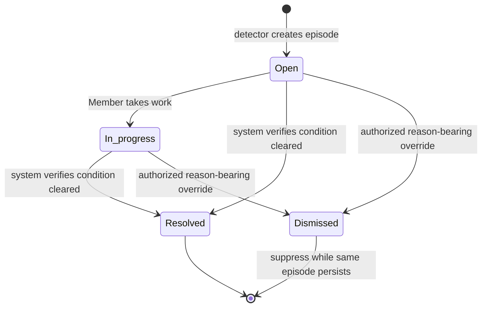
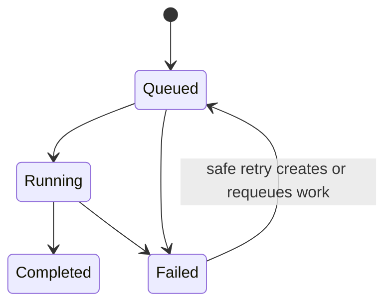

# 2Brain dashboard v1 product and implementation specification

Status: approved for implementation

Date: 2026-07-10

Product name: 2Brain

Technical compatibility name: gbrain

## 1. Authority and intent

This specification consolidates the approved product interview into one implementation handoff. `CONTEXT.md` defines canonical vocabulary. The 44 accepted ADRs in `docs/adr/` (numbered 0001–0045; number 0019 was never assigned to an accepted decision) record the decisions and their rationale. When documents conflict, the later ADR wins; ADR-0035 explicitly supersedes ADR-0006.

The product objective is to present 2Brain as an organization's shared memory and coordination layer. A Member must be able to answer five questions without interpreting an analytics dashboard:

1. What Knowledge is available to me?
2. Where did it come from?
3. Is its Source current?
4. Which Agents retrieved, wrote, or cited it?
5. What condition requires attention next?

V1 prioritizes operational clarity and trustworthy evidence. It does not optimize for engagement, content creation, or aggregate analytics.

## 2. Product contract

2Brain v1 must:

- Present one shared Workspace backed by one Brain per deployment.
- Give all Members one coherent product shell and show administrative capabilities only to Administrators.
- Enforce role and Source Access on the server; hidden controls are never the authorization boundary.
- Show live data, honest empty states, and explicit failures. Production mock data is prohibited.
- Keep Knowledge inspection-first and trace every Page to its Source and available evidence.
- Derive Source Freshness from shared commit/content-aware backend logic, never from a dashboard-only formula.
- Coordinate actionable conditions through one system-generated shared Attention Queue.
- Represent Agents as durable identities with accountable owners, cumulative scope tiers, explicit Source Access, and structured activity.
- Make deterministic Search the default and Ask 2Brain an explicit, cited, single-question synthesis action.
- Refuse unsupported Ask answers rather than presenting an uncited guess.
- Adopt Notion's current visual and interaction system only through traceable design evidence.
- Preserve original 2Brain identity and avoid Notion trademarks or proprietary assets.

## 3. Explicit non-goals

V1 does not include:

- Rich Page editing or a competing content-management system.
- User-created tasks or arbitrary Attention Items.
- A persistent chat, chat history, personas, or conversational memory.
- Cross-Workspace switching, multi-Brain web federation, or a shared identity plane across deployments.
- Public Pages, anonymous sharing, or search-engine indexing.
- SaaS Sources such as Notion, Drive, or Slack until real adapters exist.
- Browser selection of arbitrary server-local paths.
- Custom retention periods.
- Enterprise SSO.
- A composite health score, charts-first Home, or a separate analytics destination.
- Separate Capture, Relationships, Quality, Marketplace, Operations, or legacy Admin destinations.
- Migration of legacy Sources, Pages, logs, Agents, credentials, settings, or other stored data.
- A legacy-UI feature flag or parallel interface.

## 4. Deployment and cutover

One deployed server hosts one Workspace and one BrainEngine. V1 starts with a fresh empty Brain backing the Workspace. Legacy storage is disconnected and cannot affect new results; an operator may delete it separately after launch verification.

| Concern | V1 contract |
|---|---|
| Product shell | `/app` |
| Passwordless entry | `/login` |
| Workspace Setup | Single-use setup link generated with the existing bootstrap credential |
| Existing `/admin` bookmarks | Redirect authenticated Administrators to role-gated Settings; unauthorized Members land safely in `/app` without learning protected data |
| Existing API/OAuth routes and technical identifiers | Remain compatible at the code and route level where required |
| Stored legacy data/auth records | Never imported into the new Brain |
| Rollback | Restore the prior release as a whole; do not expose a legacy-UI toggle inside 2Brain |

The setup link collects the Workspace name and first Administrator email, creates exactly one Workspace and Administrator Membership, and sends a single-use confirmation magic link. It never guesses a human identity or converts a bootstrap/API credential into one.

## 5. People, roles, and authorization

### 5.1 Human roles

V1 has two human roles:

- Member: enters the Workspace, browses permitted Knowledge, inspects permitted Agent Activity, and works permitted Attention Items.
- Administrator: a Member additionally authorized to manage the Workspace, Members, Sources, Agents, automations, security, and operational records.

Source Access is independent of role:

- All Sources includes current and future Sources.
- Specific Sources includes only the selected Sources; new Sources are excluded.
- No Source Access is fail-closed and must produce an access-required state, not an apparently empty Brain.

The one explicit exception is administrative oversight of structured Agent Activity. Administrators can inspect complete structured Agent Activity even outside their personal Source Access, but cannot browse ordinary Page content through that exception. Raw prompts remain excluded by default.

### 5.2 Surface and action matrix

| Capability | Member | Administrator |
|---|---:|---:|
| Enter Workspace and use preferences | Yes | Yes |
| View Home | Authorized data only | Full operational summary |
| Browse/Search Pages | Source Access only | Source Access only |
| Ask 2Brain | Source Access only | Source Access only |
| Copy internal Page/Ask Result link | Yes, authorization rechecked | Yes, authorization rechecked |
| View Agent Directory | Yes | Yes |
| View structured Agent Activity | Source Access only | Complete administrative oversight |
| View Attention Queue | Authorized items only | Complete queue |
| Assign/work permitted Attention Item | Yes | Yes |
| Dismiss protected/system-wide condition | No unless policy explicitly permits | Yes, reason required |
| Invite/remove Members and change roles | No | Yes |
| Change Member Source Access | No | Yes |
| Add/configure/archive/restore/delete Sources | No | Yes |
| Register/revoke Agents and credentials | No | Yes |
| Change Agent owner, tier, or Source Access | No | Yes |
| View Connected Apps | Own Membership only | Workspace-wide, including disabled Members |
| Change/revoke Connected App access | Own connections, up to Write | Any connection, up to Admin; immutable audit required |
| Inspect Request Detail, health, jobs, audit | No | Yes |
| Export Workspace | No | Yes |
| Delete Workspace/Brain | No | No; operator only |

Administrative navigation entries are absent for a Member, not disabled. A direct request to an administrative route receives a safe authorization response and no protected payload.

### 5.3 Authentication and sessions

- Invitations and normal sign-in use single-use email magic links.
- Workspace Sessions use Secure, HttpOnly, SameSite cookies and are inaccessible to browser JavaScript.
- Tokens are stored hashed, expire, and are single-use where applicable.
- State-changing browser requests require CSRF protection and origin validation.
- Invitation redemption binds the invited email to one Member Identity and Workspace Membership.
- Bootstrap remains setup/break-glass authority, not a normal Member session.
- Credential creation reveals a secret once. Listing APIs never return the secret again.

## 6. Information architecture and routes

### 6.1 Primary navigation

The expanded desktop sidebar contains exactly five primary destinations:

1. Home
2. Knowledge
3. Sources
4. Agents
5. Attention

Global Search, Ask 2Brain, Notifications, identity/Workspace menu, and Settings are utilities rather than additional primary destinations. Pinned or recent Sources may appear as a restrained sidebar section but do not become a Page tree.

### 6.2 Route contract

| Route | Purpose |
|---|---|
| `/login` | Request or redeem passwordless entry |
| `/app` | Home |
| `/app/knowledge` | Knowledge View and Saved Views |
| `/app/knowledge/:pageId` | Stable Page detail link |
| `/app/sources` | Source list |
| `/app/sources/:sourceId` | Source detail |
| `/app/agents` | Agent Directory |
| `/app/agents/:agentId` | Agent detail and authorized activity |
| `/app/attention` | Attention Queue |
| `/app/attention/:attentionId` | Attention Item detail |
| `/app/search` | Addressable deterministic Search state |
| `/app/ask/:resultId` | Temporary, access-controlled Ask Result |
| `/app/notifications` | Personal Notifications |
| `/app/settings/:section?` | Route-backed Settings modal over the current Workspace context |

Closing a route-backed modal returns focus and restores the underlying route. Every stable Workspace Link rechecks the current session, Workspace Membership, and Source Access when opened.

### 6.3 Shell behavior

- Desktop and tablet receive the complete experience.
- The sidebar collapses to Notion's evidenced collapsed pattern; on narrow screens it becomes a drawer, not a bottom navigation bar.
- Mobile supports Member workflows and status-only Administrator inspection. High-risk administrative mutation remains desktop/tablet only in v1.
- Appearance defaults to System and offers Light and Dark.
- Live updates do not move list rows while a Member is reading. Show `N new updates`; apply them on request or safe navigation.
- Connection loss is persistent and explicit. Last Trustworthy State may remain visible only with a potentially-outdated explanation and retry.

## 7. Screen and flow requirements

### 7.1 Login and Workspace Setup

Normal login contains one email input and an honest confirmation state. It must not imply password support or open registration.

The operator-generated Workspace Setup flow contains:

1. Setup-link validation.
2. Workspace name.
3. First Administrator email.
4. Impact summary: one fresh Workspace and empty Brain; no legacy import.
5. Confirmation and email-link delivery.
6. Magic-link verification and entry into the Setup Checklist.

Expired, already-used, invalid, email-delivery-failed, and server-initialization-failed states preserve entered non-secret data and present a specific recovery action plus request ID.

### 7.2 First-run Setup Checklist

The first Administrator sees a Home checklist in this order:

1. Add an HTTPS Managed Git Source.
2. Complete its first synchronization.
3. Inspect one compiled Page and its provenance.
4. Invite Members and grant Source Access.
5. Register the first Agent with least privilege.

Steps reflect live completion evidence rather than a manually checked box. The checklist leaves Home after completion and remains accessible in Settings.

A Member sees `Workspace is being set up` only while the entire Workspace has no synchronized Knowledge. Once Knowledge exists, a Member with No Source Access sees `Access required`, with guidance to contact an Administrator. Neither state exposes setup controls, Source names, counts, or fabricated data.

### 7.3 Home

Home answers whether shared memory is trustworthy and what needs attention. It uses a spacious document canvas with restrained sections, not bento cards or charts.

Required sections:

- Trust Summary: plain-language statements linking to the underlying Source, Attention, or Background Operation evidence. No score, grade, percentage, or health ring.
- Attention: prioritized authorized Open and In progress items, with assignee and next action.
- Recent changes: state-changing events only; reads and searches are excluded.
- Background Operations: active or recently failed work with durable progress.

Home states are cause-specific: empty Workspace/setup, No Source Access, no active Attention, no recent changes, failed load with Last Trustworthy State, and connection loss.

### 7.4 Knowledge

Knowledge is a server-driven table/list modeled on a Notion database, not an expandable Page tree.

Default visible properties:

- Page title.
- Type.
- Source.
- Evidence Status: Cited, Source-backed, or Missing evidence.
- Source Freshness.
- Last changed.
- Recent evidenced Agent relationship when available: Retrieved by, Written by, or Cited by.

Members can search within the view, filter, sort, choose visible properties, and switch Saved Views. Every collection action is server-side and cursor-paginated. A Saved View stores stable filter, sort, and visible-property choices; it never changes Source Access.

Selecting a row opens Page detail using the Notion side-peek pattern at desktop/tablet when that controlled reference is approved; the stable full route remains available for links and mobile.

Required empty states distinguish:

- Empty Workspace.
- No Source Access.
- Authorized Sources with no compiled Pages.
- Active filters with no matches.
- Search with no matches.
- Failed request with or without Last Trustworthy State.

### 7.5 Page detail

The Page trust header appears before rendered content and contains:

- Title and type.
- Source and original location.
- Page Provenance: ingestion path and available timestamps.
- Source Freshness with its evidence.
- Evidence Status with a plain-language explanation.
- Available Agent relationships using only Retrieved by, Written by, and Cited by.

Controlled actions are Copy Workspace Link, Copy citation, Open original Source, and Flag quality. Refresh is visible only where the Member is authorized to request it; rich editing and browser revert are excluded.

The body renders compiled Knowledge read-only. Citations link to their traceable original when permitted. Agent relationship details remain Source-authorized for Members.

Page history opens as an evidenced side panel and shows Page Versions newest first. A version shows timestamp, available cause/actor only when recorded, and a diff against an adjacent or selected version. Unknown remains `Unknown`; 2Brain never fabricates authorship. V1 has no UI revert.

### 7.6 Sources

The Sources list exposes:

- Name.
- Kind: Managed Git or Local.
- Freshness: Current, Due soon, Stale, or Unknown freshness.
- Expected Cadence.
- Last successful verification.
- Included in Workspace Search.
- Active Attention state.

Members may inspect only permitted Sources. Administrators can add an HTTPS Managed Git Source. Local Source paths remain CLI-only and cannot be changed through the browser.

The add flow collects a validated HTTPS Git URL, immutable Source ID/name, Expected Cadence, and `Included in Workspace Search` (on by default). It previews the confined managed location conceptually without exposing a writable server path. Creation launches a Background Operation; the browser remains usable.

Source detail contains:

- Freshness explanation and verification/synchronization evidence.
- Current Background Operation and recent outcomes.
- Page count and link to a filtered Knowledge View.
- Authorized Agent access summary.
- Related Attention history.
- Administrator-only configuration and lifecycle actions.

Archive is the normal removal action. It stops search, synchronization, and automation while retaining content/history. Restore reverses it. Permanent deletion appears only for Archived Sources under Settings, shows an impact preview, requires the immutable Source ID, purges eligible Source content, and retains redacted lifecycle and immutable Audit Events.

### 7.7 Agents

The Agent Directory is organization-visible and contains name, purpose, Agent Owner, active/revoked status, product scope tier, Source Access summary, and last activity. It does not expose secrets or raw request content.

An Agent is durable; an Agent Run is nested activity. New Agents require:

- Name and purpose.
- One accountable Agent Owner.
- Read tier by default.
- No Source Access by default.
- Credential type supported by the preserved backend.

Product scope tiers are cumulative:

- Read → backend read capabilities.
- Write → Read plus backend write capabilities.
- Admin → Write plus approved backend administrative capabilities.

Source Access is All Sources, Specific Sources, or No Source Access. Admin is never preselected. Credential material is shown once with an explicit copy action and cannot be recovered later; rotation creates new material and revokes old material through an auditable operation.

Agent detail shows identity, owner, purpose, tier, Source Access, credential metadata, structured activity, and runs. Ordinary Members see activity only for Sources they can access. Administrators see complete structured activity through the explicit oversight exception. Full request parameters are disabled by default; if enabled, Request Detail is redacted, Administrator-only, and retained for seven days.

### 7.8 Attention

Attention is a shared, authorization-filtered operational queue. Members cannot create arbitrary items.

List properties:

- Condition summary.
- Category: Source health, Knowledge quality, Agent access, or Automation health.
- Affected resource.
- Status: Open, In progress, Resolved, or Dismissed.
- Optional Assignee.
- Detected time and latest verification time.

The detail view explains the evidence, impact, next recommended action, history, assignee, and verification state. A Member may take ownership, move an item to In progress, perform the linked action, and request verification. Resolved is set only after 2Brain confirms the condition is gone. Dismissed requires a reason and creates an Audit Event when the action is protected.

Deduplication uses Condition Episodes. At most one active item exists per condition type and affected resource during an uninterrupted episode. Source-specific verification/synchronization failure belongs to Source health; Automation health is reserved for orchestration not owned by one Source. Dismissal suppresses the same continuing episode. If the condition clears and later returns, a new item may be created.

### 7.9 Search and Ask 2Brain

Global entry defaults to deterministic Search. Search returns authorized Pages with title, matching context, Source, Evidence Status, and Source Freshness. It supports server-side filters and sorting. Inaccessible Pages are not returned and their existence is not disclosed.

Ask 2Brain is an explicit adjacent action, not an automatic interpretation of every search. Each submission contains one question. It:

1. Acknowledges within one second.
2. Shows searched permitted Sources and durable progress.
3. Begins progress or streamed content within three seconds when the backend is healthy.
4. Keeps Cancel available throughout synthesis.
5. Returns a cited answer or `Not enough evidence`.

A supported answer links every material organizational claim to permitted Pages. `Not enough evidence` names the Evidence Gap, Sources searched, relevant stale/inaccessible conditions without leaking protected resource identities, and a next action. General-model guessing is prohibited.

Ask Results are temporary snapshots retained for 30 days. They never become Pages, never enter Search, and never feed future retrieval. A copied Ask Result link rechecks current Source Access against every cited Source when opened.

### 7.10 Notifications

Notifications are personal and targeted. They are generated for assignment, a changed condition owned by the Member, work initiated by the Member, invitation/access changes, and other direct responsibility—not for every new Attention Item.

Notifications support unread/read and archive behavior and link to the durable resource. Archiving a Notification never changes the Attention Item or operation. Notifications expire after 30 days.

### 7.11 Settings

Settings is a route-backed two-pane modal grounded in U-03. It is part of the Workspace shell, not a separate admin website.

All Members see:

- Identity/profile.
- Preferences.
- Notifications.
- Appearance: System, Light, Dark.
- Session/logout controls.
- Their own Connected Apps with Configured and Effective Access Levels, role/client-limited choices, and pair-wide revocation.

Connected App choices use reason-specific copy: a disabled level identifies the Connector Client registration ceiling, the target Membership role ceiling, or both. Omitted DCR scope permits the full consent range while Read remains preselected; explicit client scopes remain hard ceilings. Existing Read registrations are never silently widened and require targeted client revocation, fresh DCR, and fresh consent to reconnect.

Only Administrators see grouped sections for:

- Workspace general.
- Members and Invitations.
- Member Source Access.
- Sources and archived Sources.
- Agents, scopes, owners, Source Access, and credentials.
- Automations and Background Operations.
- Health and Request Detail.
- Security and session policy.
- Retention.
- Audit Events.
- Workspace Export.
- Every Member's Connected Apps, including disabled Memberships, with audited level changes and revocation.

Whole Workspace/Brain deletion is absent. Settings rows use explicit supporting text and right-aligned controls. Destructive actions require impact preview, strong confirmation, reason where policy requires it, and immutable Audit Event.

## 8. State models

### 8.1 Source Freshness

| State | Entry rule | Attention behavior |
|---|---|---|
| Current | Verified within Hourly/Daily/Weekly cadence with no known unsynchronized change; or a Manual Source whose latest requested verification succeeded and has no known change | None |
| Due soon | Final 20% of an Hourly/Daily/Weekly cadence without a newer success | Informational only |
| Stale | Timed cadence elapsed; discovered changes remain unsynchronized; or requested verification failed | One Source-health condition episode |
| Unknown freshness | Insufficient successful verification evidence | Explain honestly; create Attention only when a defined actionable detector applies |

Manual has no time deadline and never becomes Due soon or Stale from elapsed time alone.

### 8.2 Attention lifecycle



If a cleared condition later returns, it begins a new Condition Episode and may create a new Open item.

### 8.3 Background Operation lifecycle



Progress and outcome remain visible from the affected resource. Failure creates one appropriately categorized Attention Item and supplies a safe retry when the operation is retryable.

### 8.4 Evidence Status

| State | Meaning | Actionability |
|---|---|---|
| Cited | Explicit traceable citations are present | Informational |
| Source-backed | Original Source is traceable but claims lack explicit citations | Informational in v1 |
| Missing evidence | Neither adequate citation nor traceable original is available | Knowledge-quality Attention Item |

No numeric evidence or confidence percentage appears in v1.

## 9. Backend capability and gap map

The current repository provides strong Knowledge, Search, OAuth, request-log, Source, and job primitives. It does not yet provide the shared human Workspace control plane. Existing `/admin` endpoints must not be exposed to Members without new authorization.

| Area | Reuse | Required v1 work |
|---|---|---|
| Brain topology | One `BrainEngine` per HTTP server already matches one Workspace per deployment | Point 2Brain to a fresh Brain; create singleton Workspace state; refuse setup against a populated legacy Brain; keep the mandatory empty `default` Source hidden as an internal compatibility detail |
| Human auth | Bootstrap validation, timing-safe secret comparison, rate limiting, cookie support | Durable identities, memberships, invitations, hashed login tokens, sessions, email delivery/outbox, Member/Admin middleware, and bootstrap setup/recovery restriction |
| Source Access | Source-scoped engine queries and existing OAuth `source_id`/federated concepts | Implement explicit All/Specific/None policies and close fail-open paths where empty grants fall back to `default`, requested Sources bypass empty grants, or Source list/status ignores grants |
| Sources | HTTPS-only SSRF-defended Git clone, confined managed clones, sync, metrics | Async provisioning, durable failure state, Expected Cadence, verification evidence, `last_verified_at`, indefinite Archive, and browser-safe lifecycle APIs |
| Knowledge | Composite Page identity, versions, tags, ingestion, provenance fields | Member DTOs, cursor pagination, Source identity in every row, original path, Evidence Status, Saved Views, version cause/actor evidence, and deletion semantics |
| Search | Mature hybrid retrieval and Source filters | Member endpoints, access-safe empty state, cursor/total behavior, trust enrichment, and composite Page links |
| Ask | Existing retrieval/synthesis/citation primitives | Scope every retrieval arm, validate every citation against current access, enforce refusal, persist temporary Ask Results, stream progress, and support cancellation |
| Agents | OAuth clients/tokens, scopes, revocation | Durable Agent identity, owner, purpose, status, cumulative tier, Source Access, credential links, and Agent Runs |
| Agent Activity | Operation, client, status, latency, and privacy-safe parameter shapes | Source/Page relationship events for Retrieved/Written/Cited, Member filtering, run linkage, and retention |
| Background Operations | Durable Minion jobs with progress/retry/cancel/idempotency | Always-on worker/scheduler, initiator and resource linkage, web-safe projection, and 30-day detail purge |
| Attention/Notifications | Health, failed-job, citation, and doctor signals | Durable detector output, lifecycle, assignment, verification, dismissal, episode deduplication, authorization, history, and targeted Notification rules |
| Audit/changes | Several specialized JSONL audits and ingest logs | One transactional immutable Audit Event store and one member-facing Change Event store covering every protected browser mutation |
| Retention/export | Markdown export and isolated purge helpers | Fixed purge policy and allowlisted, secret-free Workspace Export with versions, authorization, Attention, changes, and manifest |
| Web shell | Express, OAuth/MCP routes, embedded Vite SPA | Modular Workspace API, correlation IDs, safe errors, authenticated update stream, `/app`, new membership authorization, and deletion of the legacy frontend |

### 9.1 P0 security blockers

No Member or Agent production flow may ship until these are fixed and tested:

1. No Source Access must produce zero accessible Sources and zero Knowledge. It must never fall back to `default`.
2. A caller cannot request a Source outside its All/Specific grant through any MCP or Workspace API parameter.
3. Source list/status, Page reads, tags, links, backlinks, timelines, Search, graph retrieval, Ask retrieval, and write operations must all enforce the same Source policy.
4. Ask must pass the effective Source policy into every retrieval arm, then verify every returned citation against current access before storing or rendering it.
5. Administrator Agent-Activity oversight must use a separate explicit authorization path and must not silently widen ordinary Knowledge reads.

## 10. Implementation architecture

### 10.1 Runtime topology

The approved organizational scale and durable worker requirements make Postgres the production v1 datastore. PGLite remains supported for local CLI use, development, isolated tests, and schema parity, but is not the shared multi-Member production topology.

Production consists of:

- One web process serving `/app`, Workspace APIs, preserved OAuth/MCP routes, and authenticated update events.
- One or more durable workers processing Source provisioning/synchronization, verification, Ask synthesis, export, retention, and detector work.
- One Postgres Brain database containing existing Knowledge tables and the new Workspace control-plane tables.
- Confined managed-clone storage accessible to the web/worker deployment boundary.
- An email delivery adapter with a durable outbox for invitations and magic links.

### 10.2 Code organization

`src/commands/serve-http.ts` remains the composition root but should not absorb another large inline route set. Add a modular `src/web/` boundary with separate route, service, policy, and serializer modules for:

- setup and authentication;
- sessions and authorization;
- members and Source Access;
- Sources and Background Operations;
- Knowledge, Saved Views, and Search;
- Agents and structured activity;
- Attention and Notifications;
- Ask Results;
- Settings, Audit Events, retention, and export;
- safe errors, correlation IDs, pagination, and update events.

Existing domain primitives remain below that boundary, especially `src/core/operations.ts`, engine implementations, `src/core/source-health.ts`, hybrid Search, OAuth provider, Source management, and Minion/job infrastructure.

The existing `admin/` directory may remain as the embedded frontend packaging location so build scripts do not need an unrelated protocol rename, but its old routes, components, styles, mock data, navigation, and visual design are deleted. It becomes the 2Brain `/app` React/Vite application only.

### 10.3 Schema parity

All new schema changes must remain structurally equivalent in Postgres and PGLite through the repository's canonical schema/migration path, including `src/core/migrate.ts`, `src/schema.sql`, `src/core/pglite-schema.ts`, and the embedded schema artifact. Production-only worker behavior may require Postgres, but schema and core authorization tests still run against both engines.

## 11. Durable data model

Names below are logical contracts; physical naming follows repository conventions. Every durable table has an immutable identifier, timestamps, and the indexes required by the scale target.

| Entity | Required fields/invariants |
|---|---|
| Workspace | Exactly one active row per deployment; name; setup completion; appearance defaults; created time |
| Member Identity | Normalized unique email; display name; state; no password hash |
| Workspace Membership | Workspace + identity unique; role Member/Administrator; active/disabled; invitation/actor provenance |
| Invitation | Workspace, normalized email, target role, initial Source policy, hashed single-use token, expiry, inviter, redemption state |
| Login Token | Hashed single-use token, Member Identity, expiry, consumed time, request metadata safe for audit |
| Workspace Session | Hashed session token, identity/membership, issued/expiry/revoked time, last activity, safe device metadata |
| Principal Source Policy | Principal type/member-or-Agent, principal ID, policy All/Specific/None; Specific requires explicit grant rows; absence resolves to None |
| Source Grant | Principal policy + Source ID unique; never interpreted when policy is None; new Sources included only by All |
| Agent | Name, purpose, required Agent Owner Membership, status, cumulative product tier, created/revoked metadata |
| Agent Credential | Agent ID, legacy API-key or OAuth-client reference, non-secret metadata, created/revoked/last-used time; secret never stored recoverably beyond existing secure hash behavior |
| Connected App Policy | Membership ID + OAuth client ID unique; configured Read/Write/Admin; original connected time preserved across re-consent; current update time; absence fails closed and revocation deletes the entire pair's tokens, codes, and policy |
| Agent Run | Agent, external correlation ID when available, start/end/outcome, safe metadata |
| Agent Activity | Agent/run/request, operation, outcome, latency, Source/Page references when evidenced, relationship Retrieved/Written/Cited, redacted detail pointer, timestamp |
| Source Policy | Existing Source ID, Expected Cadence, Included in Workspace Search, archive/provisioning state, immutable display identity |
| Source Verification Event | Source, requested/start/end time, observed revision/content state, outcome, error code/request ID; unchanged success still proves verification |
| Background Operation | Type, initiator, affected resource, Queued/Running/Completed/Failed, progress, cancel/retry metadata, result/error summary |
| Page Evidence Projection | Composite Page identity, Evidence Status, evaluated time, detector version and explainable inputs |
| Saved View | Owner Membership, target collection, name, allowlisted filter/sort/visible-property JSON, updated time |
| Attention Item | Condition type, affected resource, category, episode key, status, assignee, first/latest detection, verification state, dismissal reason when applicable |
| Attention Event | Item, transition/action, actor or system detector, redacted before/after, reason, timestamp |
| Notification | Recipient Membership, event type, durable target, unread/read/archived state, expiry |
| Change Event | Authorized member-facing state change, actor type/ID, resource, safe summary, timestamp |
| Audit Event | Append-only protected action, actor, target, action, result, redacted before/after, reason when the closed action policy requires one, request ID, timestamp |
| Ask Result | Requesting Membership, question, state/progress, cited Page/Source references, answer or Evidence Gap, expiry, cancellation and error metadata |
| Workspace Export | Requesting Administrator, Background Operation, manifest metadata, artifact location/expiry, checksum, outcome |

Important constraints:

- Page identity remains composite across Source and Page slug/ID; a slug alone is not a global identifier.
- At most one open/in-progress Attention Item exists for an episode key.
- Audit Events are insert-only through application and database permissions.
- A Member/Agent policy with no grant rows is None, never All.
- Ask Result access is the intersection of current Membership, current Source Access, and every cited Source—not the requester's historical access.
- The internal seeded `default` Source remains hidden while it has no user-visible content and must never function as an authorization fallback.

## 12. Workspace API contract

Mount a new versioned Workspace API separately from preserved OAuth/MCP compatibility routes, for example `/api/workspace/v1`. Exact handlers remain modular even if the final prefix changes.

Every response includes or exposes:

- A correlation/request ID.
- Server generation time where freshness matters.
- Stable resource IDs.
- Cursor pagination for collections.
- Only fields authorized for the current Membership.
- A safe structured error on failure.

The safe error shape is logically:

```json
{
  "error": {
    "code": "stable_machine_code",
    "message": "Plain-language explanation",
    "recovery": "Specific next action",
    "retryable": true,
    "request_id": "opaque-id"
  }
}
```

Raw exceptions, filesystem paths, SQL, tokens, credential material, full prompts, and protected resource identities never enter this response.

### 12.1 Required resource groups

| Group | Required operations |
|---|---|
| Setup/Auth | Validate setup link; create Workspace/first Administrator; request/redeem login; logout; inspect/revoke current sessions |
| Session | Current Member, role, effective Source policy summary, Workspace identity, feature availability |
| Members | List/invite/disable; change role; set All/Specific/None Source Access |
| Sources | Cursor list/detail; create Managed Git Source; verify/sync; configure cadence/search inclusion; archive/restore; impact preview/delete |
| Knowledge | Cursor list with filters/sort; Page detail; history; diff; copy-citation data; Saved View CRUD |
| Search | Deterministic authorized Search with filters/sort/cursor and trust context |
| Ask | Submit; stream/progress; cancel; get temporary result; access-controlled link |
| Agents | Directory/detail; register; set owner/tier/Source Access; rotate/revoke credential; runs/activity cursor list |
| Attention | Queue/detail; assign; start work; request verification; dismiss with reason; history |
| Notifications | Cursor list; mark read/unread; archive; unread count |
| Operations | Authorized progress/detail; retry/cancel where safe |
| Settings | Preferences; health; Request Detail; retention statement; Audit Events; start/get Workspace Export |
| Connected Apps | Member-own/Administrator-wide logical-pair list; self and Administrator pair access-level update; pair-wide revoke; Configured/Effective projection plus per-option client/role/status limiter reasons |

Mutation endpoints use idempotency keys where retries could duplicate external or destructive work. Concurrent edits use version/updated-at preconditions and return a recoverable conflict rather than silently overwriting another Administrator's change.

### 12.2 Update events

Use an authenticated server-sent event stream for resource invalidations, Background Operation progress, targeted Notifications, and `new updates` counts. Events contain IDs and minimal safe summaries, not Page content or secrets. Support reconnection with the last event ID and a polling fallback that still satisfies the five-second live-update budget.

The client invalidates affected queries but does not reorder a visible list automatically. It increments the local new-update count until the Member applies the update.

## 13. Source, Attention, and Ask processing rules

### 13.1 Source provisioning and verification

Connecting a Source creates a durable provisioning record and Queued Background Operation before network work begins. The worker validates the HTTPS URL through existing SSRF controls, clones only into confined managed storage, records progress, and retains a Failed resource state for inspection/retry instead of deleting all evidence.

Verification and synchronization are distinct evidence:

- A successful check of an unchanged Git revision updates `last_verified_at` and produces a verification event.
- `last_sync_at` changes only when synchronization applies or confirms the synchronized content state according to shared backend semantics.
- Freshness is derived centrally from cadence, verification, discovered change, and synchronization evidence.
- UI, doctor, CLI, advisor, and detector projections call the same calculation.

Archived Sources are excluded from active verification, synchronization, Search, and Ask. The existing automatic archive purge behavior must be disabled or replaced so Archive remains indefinite until explicit permanent deletion.

### 13.2 Detector execution

Detectors run after relevant events and on a scheduled reconciliation pass. They return a stable condition type, affected resource, category, evidence, severity/priority inputs, and verification function.

Initial detectors:

- Source health: Stale, verification failure, synchronization failure, disconnected/unreachable Source.
- Knowledge quality: Missing evidence, supported contradiction/duplicate/orphan detectors that can produce explainable evidence.
- Agent access: repeated authorization failure or explicit access review condition.
- Automation health: failed/stalled orchestration not owned by one Source.

Detectors upsert the current Condition Episode rather than inserting duplicates. Resolution always invokes the detector's verification function. Dismissal records suppression against the current episode.

### 13.3 Ask enforcement

Before Ask can ship:

1. Resolve the requester's effective All/Specific/None Source policy once per request.
2. Thread it into hybrid, take/fact, graph, trajectory, and every other retrieval arm.
3. Intersect eligible Sources with `Included in Workspace Search` unless the Member explicitly selected an authorized Source.
4. Record the searched Source IDs and trust conditions without leaking inaccessible Sources.
5. Validate each cited Page exists, belongs to an allowed Source, and supports the stored result reference.
6. Apply the unsupported-answer policy before persistence or streaming completion.
7. Recheck access on every result retrieval and copied link.
8. Cancel downstream work promptly when the Member cancels.

## 14. Retention, export, and privacy

### 14.1 Fixed retention

| Data | Retention |
|---|---|
| Page Versions for non-deleted Sources | Until Source permanent deletion or Workspace deletion |
| Redacted Source lifecycle, access-policy history, Attention outcomes, Audit Events | Until Workspace deletion |
| Agent Activity and Change Events | 90 days |
| Ask Results, Background Operation detail, Notifications | 30 days |
| Full request parameters | Disabled by default; seven days when explicitly enabled |

A scheduled retention job deletes eligible rows in bounded batches, records its own safe operation outcome, and never deletes immutable Audit Events. Request logs and jobs must not remain unbounded.

### 14.2 Workspace Export

Export is an Administrator-initiated Background Operation. The artifact contains:

- Pages as Markdown.
- JSON Page metadata and retained Page Versions.
- Non-secret Source configuration and lifecycle.
- Member and Agent identities plus authorization policy without credential material.
- Attention history and retained Change Events.
- An export manifest with schema version, generated time, counts, checksums, omissions, and warnings.

It excludes credentials, tokens, sessions, magic links, full request parameters, provider secrets, raw protected prompts, and managed Git clone internals. The artifact is stored temporarily, access-controlled, checksum-addressed, and expires on a defined operational schedule no longer than the Background Operation detail retention.

Whole Workspace/Brain deletion remains operator-only.

## 15. Experience quality requirements

### 15.1 Notion design evidence

`docs/designs/2brain-notion-evidence-matrix.md` is a release artifact, not optional research. No visual state ships without a completed Design Evidence Entry and same-viewport comparison. The current three screenshots cover only the expanded dark desktop shell, anchored menus, basic empty-state composition, and dark desktop Settings shell. All other states require the reference pack listed there before implementation.

Unbacked bento cards, gradients, charts, invented color scales, arbitrary radii, mixed icon styles, decorative illustrations, or personal-preference spacing are prohibited.

### 15.2 Accessibility

WCAG 2.2 AA is the release threshold. At minimum:

- Full keyboard operation and visible focus.
- Correct landmark, heading, table/list, dialog, menu, status, and live-region semantics.
- Focus trap and return for modal/dialog states.
- Accessible names and tooltips for icon-only controls.
- Contrast verification in Light and Dark modes.
- Reflow at 400% zoom without loss of Member workflow.
- Target sizes and spacing appropriate to pointer and touch input.
- Reduced-motion support.
- Error association, instructions, and recovery that do not rely on color.
- Screen-reader announcement for progress, connection loss, new-update counts, and verified resolution.

When a Notion reference conflicts with AA, accessibility wins and the Design Evidence Entry documents the permitted divergence.

### 15.3 Responsive behavior

- Desktop: complete product and administration.
- Tablet: complete product and administration using evidenced responsive panels/drawers.
- Mobile: Home, Knowledge, Page detail, Sources status, Agent directory/detail, Attention work, Search, Ask, Notifications, and preferences. Administrator screens are status-only; high-risk mutation directs the Administrator to a larger viewport.
- There is no mobile bottom navigation unless a future Notion reference and ADR replace the drawer decision.

### 15.4 Loading, empty, and failure states

- Loading preserves stable layout and announces progress; its visual form requires Notion evidence.
- Empty state always identifies cause and one appropriate next action.
- Last Trustworthy State is labeled potentially outdated with timestamp and retry.
- A failed mutation preserves safe form input and current filters.
- Persistent inline errors appear at the affected surface. A toast may confirm a transient success but cannot be the only failure explanation.
- Failure detail contains time, affected resource, recommended action, and copyable request ID. Raw diagnostics remain Administrator-only.

### 15.5 Scale and performance budgets

Design and implementation target:

- 100,000 Pages.
- 100 Sources.
- 500 Members.
- 500 Agents.
- 1,000,000 retained Agent Activity and Change Event rows.

Every large collection uses indexed server-side cursor pagination, filtering, and sorting. The browser never downloads a complete organizational collection.

| Interaction | Budget |
|---|---:|
| Authenticated shell usable | 2.5 seconds p75 |
| Cached navigation response | 200 milliseconds |
| List/filter/Search result | 1 second p95 |
| Live operational change visible | 5 seconds |
| Ask acknowledgement | 1 second |
| Ask progress or first streamed content | 3 seconds |

Ask completion has no fixed deadline, but Cancel remains available and responsive.

## 16. Implementation sequence

The sequence is intentionally security-first. A later slice must not bypass an incomplete earlier boundary.

### Slice 0 — evidence and fresh deployment foundation

- Capture the minimum Notion reference pack and create the initial Design Evidence Entries.
- Provision a fresh Postgres Brain and worker topology; keep legacy storage disconnected.
- Add deployment rollback pointer/runbook.
- Hide the empty compatibility `default` Source from product projections.

Exit: clean deployment can initialize without reading legacy rows, and the first production UI states have approved visual evidence.

### Slice 1 — control-plane schema and immutable events

- Add Workspace, identity, membership, invitation, login/session, Source policy, Agent, Attention, Notification, Change, Audit, operation projection, Ask Result, Saved View, and export schema.
- Add append-only Audit Event writer and safe Change Event writer before mutation routes.
- Maintain Postgres/PGLite schema parity and indexes.

Exit: schema tests and immutable-event tests pass on both engines.

### Slice 2 — authentication and authorization

- Implement first-Administrator Workspace Setup, durable email outbox, invitation, magic-link login, session rotation/revocation, CSRF, and role middleware.
- Implement All/Specific/None for Members and Agents.
- Repair every identified Source-scope fail-open path in MCP and core operations.
- Add authorization matrix tests across list/detail/search/write/Ask-adjacent primitives.

Exit: No Source Access proves zero disclosure, and protected routes never depend on UI hiding.

### Slice 3 — modular Workspace API and Notion-grounded shell

- Add correlation IDs, safe errors, pagination, update events, `/login`, `/app`, and route-backed Settings.
- Replace the old frontend inside the embedded-app packaging boundary.
- Implement dark desktop shell only after its evidence entries pass; add other themes/viewports as references become available.

Exit: Member and Administrator enter the same shell, with role-gated navigation and no mock data.

### Slice 4 — Sources, operations, and onboarding

- Make Managed Git provisioning and sync asynchronous.
- Add verification evidence, cadence, freshness projection, indefinite Archive, restore, and safe permanent deletion.
- Add Setup Checklist and cause-specific initial states.

Exit: first Administrator completes the full Source-to-provenance onboarding loop without blocking the browser.

### Slice 5 — Knowledge, provenance, history, and Search

- Add Knowledge cursor APIs, Saved Views, Evidence Status, Page trust header, Page history/diff, and deterministic Search enrichment.
- Preserve composite Page identity and Source authorization end to end.

Exit: a Member can find and inspect permitted Knowledge and explain its provenance/currentness.

### Slice 6 — Agents and structured activity

- Add durable Agent/owner/tier/Source policy records linked to existing credential mechanisms.
- Add one-time credential reveal/rotation/revocation.
- Emit Retrieved/Written/Cited activity with Source/Page and optional run evidence.
- Implement ordinary Member filtering and explicit Administrator oversight.

Exit: the organization can identify every Agent, owner, permission, recent activity, and evidenced Page relationship without raw prompts.

### Slice 7 — Attention, Notifications, and Home

- Add detectors, Condition Episode deduplication, assignment, verified resolution, dismissal, and history.
- Add targeted Notifications and non-jumping update counts.
- Build Home Trust Summary, recent changes, active operations, and authorized Attention preview.

Exit: Home answers trust/attention questions from live evidence with no score or fabricated content.

### Slice 8 — scoped Ask 2Brain

- Repair Source scoping in every retrieval arm.
- Add citation authorization verification, unsupported-answer refusal, temporary result persistence, progress streaming, cancellation, expiry, and internal links.

Exit: Ask can neither retrieve nor cite inaccessible Knowledge and never indexes its own result.

### Slice 9 — retention, export, hardening, and cutover

- Add bounded purge jobs and the secret-free Workspace Export.
- Complete visual comparison, accessibility, responsive, security, scale, and recovery testing.
- Delete remaining legacy UI artifacts, redirect `/admin`, verify whole-release rollback, and hard cut over.

Exit: all five release gates pass.

## 17. Verification strategy

### 17.1 Required automated coverage

- Unit tests for policy resolution, freshness, evidence, detector deduplication, lifecycle transitions, retention eligibility, export allowlist, and safe errors.
- Engine-parity tests for every new schema entity and authorization query.
- Integration tests for setup, login, invitation, session expiry/revocation, Member/Admin routing, and CSRF.
- Exhaustive Source Access matrix tests for All/Specific/None across Members, legacy API keys, OAuth Agents, lists, status, reads, writes, Search, links, graph, and Ask retrieval.
- Job tests for async Source provisioning, unchanged verification, sync, retry, cancel, archive, export, and purge.
- Browser journey tests for every approved Member and Administrator flow in Light/Dark and required viewports, using the user's approved browser when execution begins.
- Accessibility automation plus manual keyboard and screen-reader verification.
- Performance tests at the target collection sizes.
- Secret scanning of API payload fixtures, logs, export archives, and built frontend assets.

### 17.2 Core acceptance scenarios

1. A fresh deployment cannot read or project any legacy row.
2. Only a valid single-use setup link can create the first Administrator.
3. A Member never receives administrative navigation or payloads.
4. No Source Access reveals neither Source identity nor Page/search/Ask content.
5. Specific Sources excludes a newly added Source; All Sources includes it.
6. A successful unchanged verification keeps a Source Current by evidence.
7. A Manual Source never becomes Due soon or Stale from time alone.
8. A persistent failure creates one Condition Episode, not duplicate Attention Items.
9. Resolved requires detector verification; Dismissed requires reason and suppresses the same continuing episode.
10. Page detail identifies Source, provenance, Freshness, Evidence Status, versions, and only evidenced Agent relationships.
11. Agent registration defaults to Read and No Source Access; no secret is recoverable after reveal.
12. Ordinary Members cannot inspect activity from inaccessible Sources; authorized Administrators can inspect structured activity without gaining Page browsing.
13. Search is deterministic and Source-authorized.
14. Ask refuses unsupported answers, cites only currently permitted Pages, can be cancelled, expires after 30 days, and never becomes Knowledge.
15. A failed request preserves Last Trustworthy State or form input and exposes a request ID without raw diagnostics.
16. Export contains every allowlisted category and no credential, token, session, full parameter, provider secret, or managed clone content.
17. Live updates appear within five seconds without moving the current list until applied.
18. Every visible state has a passing Design Evidence Entry and WCAG 2.2 AA result.
19. New consent defaults to Read; omitted-scope DCR offers Read/Write/Admin to an Administrator and Read/Write to a Member, while explicit client scopes remain additional ceilings and disabled options name the exact limiter.
20. Changing, demoting, disabling, or revoking a Connected App affects every existing credential on its next use; higher re-consent never widens a credential beyond its original grant, and missing or malformed pair policy fails closed while current Member Source Access remains authoritative.

## 18. Five-part release gate

V1 ships only when all five independent gates pass:

1. Functional: every approved Member and Administrator flow works end to end.
2. Trust: provenance, Freshness, verified Attention, Agent Activity, Search, and Ask use live evidence only.
3. Security: server-side role/Source Access tests pass, and secrets are absent from browser payloads, logs, and exports.
4. Experience: Notion design evidence, same-state visual comparisons, WCAG 2.2 AA, responsive behavior, and performance budgets pass.
5. Operations: clean setup, worker recovery, retention, immutable audit, export, and whole-release rollback are verified.

Passing one gate never compensates for failing another. The final sign-off artifact links the test run, security matrix, Design Evidence ledger, accessibility report, performance report, export inspection, and rollback rehearsal.
